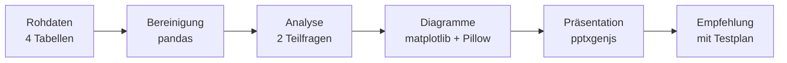

# Eniac · Lohnen sich die Rabatte?

[English](README.md) · **Deutsch**

### Rabattanalyse für einen Onlinehändler für Apple-Produkte

**Lohnen sich Eniacs Rabatte?**
Eine datengestützte Antwort für den CEO: Python → Diagramme → Präsentation → Empfehlung


[](video/Eniac_Praesentation_Video.mp4)

*Die Präsentation im Schnelldurchlauf, doppelte Geschwindigkeit. Ein Klick öffnet das vollständige Video (2:24 Minuten, ohne Ton); die Folien gibt es auch [als PDF](presentation/Eniac_CEO_Praesentation.pdf).*

[Projekt](#projekt) · [Frage](#frage) · [Kernzahlen](#kernzahlen) · [Vorgehen](#vorgehen) · [Ergebnisse](#ergebnisse) · [Empfehlung](#empfehlung) · [Mein Beitrag](#mein-beitrag) · [Dateien](#dateien) · [Team](#team)

---

## Projekt

Eniac ist ein Onlinehändler für Apple-Produkte und Zubehör in Spanien. Fast alles wird dort mit Rabatt verkauft. Der CEO wollte wissen, ob sich das lohnt. Unsere Aufgabe als Team: die Verkaufsdaten von Januar 2017 bis März 2018 auswerten und die Antwort in einer 5-Minuten-Präsentation vortragen, mit einem Anhang für Rückfragen.

> Gruppenprojekt der Weiterbildung „Data Analysis and AI“ der WBS Coding School, präsentiert am 13. November 2026. Eniac ist ein Fallbeispiel des Kurses.

## Frage

> **Lohnen sich Eniacs Rabatte?**

| # | Teilfrage | Sicht | Antwort |
|---|---|---|---|
| 1 | Bringen Rabatte Umsatz? | Marketing | Ja, aber nicht überall. |
| 2 | Kosten Rabatte uns Umsatz und Ruf? | Vorstand | Den Ruf nicht, aber Geld an der falschen Stelle. |

**Gesamtantwort:** Wir verlieren kein Geld. Aber wir verpassen Geld, das wir noch nicht verdienen.

## Kernzahlen

**Datengrundlage**

| Kennzahl | Wert |
|---|---|
| Zeitraum | 437 Tage (Januar 2017 bis März 2018) |
| Abgeschlossene Bestellungen | 46.605 (von 226.909 vor der Bereinigung) |
| Produkte im Katalog | 9.992 (von 19.326 vor der Bereinigung) |
| Umsatz | 15,9 Mio. € |

**Rabatt**

| Kennzahl | Wert |
|---|---|
| Rabattierte Positionen | 93 % (56.203 von 60.375) |
| Stärkster Monat | November 2017: 2,89 Mio. € Umsatz, 21,5 % Ø Rabatt |
| Macs | 41 % des Umsatzes, nur 10,3 % Rabatt, aber 0,77 Mio. € Rabattgeld |
| Apple gesamt | rund 11 % Rabatt, aber 1,17 Mio. € Rabattgeld, fast die Hälfte des gesamten Rabattgelds |
| Andere Marken | rund 18 % Rabatt, dreimal so viele verkaufte Geräte, aber weniger Umsatz |

## Vorgehen



1. **Daten bereinigen.** Nur abgeschlossene Bestellungen zählen als Umsatz. 36.169 Stückpreise standen als Text im Format `1.234.56`. Weil alle dieses Format haben, ist der erste Punkt eindeutig ein Tausenderpunkt; wir haben ihn entfernt, statt die Zeilen zu löschen (das hätte rund 46 % des Umsatzes gekostet). Im Katalog war das Format nicht eindeutig, deshalb haben wir dort 542 Preise gelöscht: Ein fehlender Preis ist sichtbar, ein falsch reparierter verfälscht den Rabatt unbemerkt. Dazu kamen Duplikate und Zeilen mit fehlenden Werten.
2. **Arbeitstabelle aufbauen.** Jede verkaufte Position mit Umsatz, Listenumsatz, Rabatt in Prozent und in Euro, Kategorie und Marke.
3. **Die zwei Teilfragen beantworten.** Monatsverlauf, Kategorien, Marken, Preisklassen und der direkte Vergleich Apple gegen andere Marken.
4. **Empfehlung durchrechnen.** Was ein Prozentpunkt Apple-Rabatt wert ist, wie viele Käufe wegfallen dürften, und was ein Umschichten des Rabatts bringen würde.
5. **Präsentieren.** Eine Hauptfrage, zwei Teilfragen mit kurzen Antworten, eine Empfehlung mit Zahlen. Alles für Rückfragen in einen Anhang mit verlinkter Übersicht (A1 bis A7).

## Ergebnisse

Ein Klick auf ein Diagramm öffnet das Notebook. Unter jedem Diagramm lässt sich der Code aufklappen, mit dem es entstanden ist.

### Rabatt ist Standard, aber der November verkauft sich von selbst

93 % aller Positionen werden mit Rabatt verkauft. Der stärkste Monat ist der November 2017 mit Black Friday und 2,89 Mio. € Umsatz.

[](code/analyse/Eniac_Rabattanalyse.ipynb)

<details>
<summary>Code zum Diagramm anzeigen</summary>

Auszug aus dem [Notebook](code/analyse/Eniac_Rabattanalyse.ipynb), Abschnitt T1.3. Er nutzt die Arbeitstabelle `basis` und die Hilfsfunktionen `de()` und `balken_abrunden()` aus der Startzelle. Die animierte Fassung entsteht nach demselben Prinzip in [`code/diagramme/bestell_linien.py`](code/diagramme/bestell_linien.py).

```python
monate = basis.groupby("monat").agg(umsatz=("umsatz", "sum"),
                                    bestellungen=("id_order", "nunique"),
                                    rabatt=("rabatt", "mean"))

fig, ax = plt.subplots(figsize=(12, 5))
x = np.arange(len(monate))
farben = [ORANGE if str(m) == "2017-11" else "#8F5420" for m in monate.index]
ax.bar(x, monate["umsatz"] / 1e6, color=farben, width=0.65)
ax.set_xticks(x, [m.strftime("%b %y") for m in monate.index], fontsize=10)
ax.set_ylabel("Umsatz in Mio. €")
ax.set_ylim(0, 3.4)

ax2 = ax.twinx()
ax2.plot(x, monate["rabatt"] * 100, color=ROT, lw=2.5, marker="o")
ax2.set_ylim(0, 30); ax2.set_ylabel("Ø Rabatt in %", color=ROT)
ax2.spines["right"].set_visible(True); ax2.tick_params(axis="y", colors=ROT)

ax.set_title("Umsatz und Ø Rabatt pro Monat · November 2017 ist der stärkste Monat")
balken_abrunden(ax, 6)
plt.tight_layout(); plt.show()

nov = monate.loc["2017-11"]
print(f"November 2017: {de(nov['umsatz'] / 1e6, 2)} Mio. € Umsatz, "
      f"{de(nov['bestellungen'], 0)} Bestellungen, Ø Rabatt {de(nov['rabatt'] * 100)} %")
print(f"Ø Rabatt über alle Monate: {de(basis['rabatt'].mean() * 100)} %")
```

</details>

### Macs tragen den Umsatz

Macs bringen 41 % des Umsatzes.

[](code/analyse/Eniac_Rabattanalyse.ipynb)

<details>
<summary>Code zum Diagramm anzeigen</summary>

Auszug aus dem [Notebook](code/analyse/Eniac_Rabattanalyse.ipynb), Abschnitt T1.4. Er nutzt die Arbeitstabelle `basis` und die Hilfsfunktionen `de()` und `balken_abrunden()` aus der Startzelle. Die animierte Fassung entsteht nach demselben Prinzip in [`code/diagramme/gifs2.py`](code/diagramme/gifs2.py).

```python
kategorien = (basis.groupby("kategorie")
              .agg(umsatz=("umsatz", "sum"), rabatt_eur=("rabatt_eur", "sum"),
                   listenumsatz=("listenumsatz", "sum"), rabatt_mittel=("rabatt", "mean"))
              .sort_values("umsatz"))
kategorien["anteil_umsatz"] = kategorien["umsatz"] / kategorien["umsatz"].sum() * 100

fig, ax = plt.subplots(figsize=(12, 6))
farben = [ORANGE if k == "Mac" else "#6B4A2A" for k in kategorien.index]
ax.barh(kategorien.index, kategorien["umsatz"] / 1e6, color=farben, height=0.62)
for i, (u, a) in enumerate(zip(kategorien["umsatz"], kategorien["anteil_umsatz"])):
    ax.text(u / 1e6 + 0.06, i, f"{de(u / 1e6, 2)} Mio. € · {de(a)} %", va="center", fontsize=11)
ax.set_xlim(0, 7.6); ax.set_xticks([])
ax.spines["bottom"].set_visible(False)
ax.set_title("Umsatz je Kategorie · Macs bringen rund 41 % des Umsatzes")
balken_abrunden(ax, 8, "rechts")
plt.tight_layout(); plt.show()

kategorien.sort_values("umsatz", ascending=False)[["umsatz", "anteil_umsatz"]].round(1).head(4)
```

</details>

### Apple: wenig Rabatt in Prozent, aber fast die Hälfte des Rabattgelds

Apple bekommt im Schnitt rund 11 % Rabatt, andere Marken rund 18 %. Weil Apple-Geräte teuer sind, gehen trotzdem 1,17 Mio. € Rabattgeld an Apple, fast die Hälfte des gesamten Rabattgelds.

[](code/analyse/Eniac_Rabattanalyse.ipynb)

<details>
<summary>Code zum Diagramm anzeigen</summary>

Auszug aus dem [Notebook](code/analyse/Eniac_Rabattanalyse.ipynb), Abschnitt T2.3. Er nutzt die Arbeitstabelle `basis` und die Hilfsfunktionen `de()` und `balken_abrunden()` aus der Startzelle. Die animierte Fassung entsteht nach demselben Prinzip in [`code/diagramme/welten3.py`](code/diagramme/welten3.py).

```python
vergleich = basis.groupby("ist_apple").agg(stueck=("product_quantity", "sum"), umsatz=("umsatz", "sum"),
                                           rabatt_eur=("rabatt_eur", "sum"), listenumsatz=("listenumsatz", "sum"))
vergleich.index = vergleich.index.map({True: "Apple", False: "Andere"})

kennzahlen = pd.DataFrame({
    "Anteil Stück": vergleich["stueck"] / vergleich["stueck"].sum() * 100,
    "Anteil Umsatz": vergleich["umsatz"] / vergleich["umsatz"].sum() * 100,
    "Ø Rabatt": vergleich["rabatt_eur"] / vergleich["listenumsatz"] * 100,
    "Anteil Rabattgeld": vergleich["rabatt_eur"] / vergleich["rabatt_eur"].sum() * 100,
}).T[["Apple", "Andere"]]
beschriftung = ["Anteil an\nverkauften Stück", "Anteil am\nUmsatz", "Ø Rabatt", "Anteil am\nRabattgeld"]

fig, ax = plt.subplots(figsize=(12, 5.5))
x = np.arange(4); b = 0.38
apple_farben = [BLAU, ORANGE, ROT, ROT]
andere_farben = ["#2A5E86", "#8F5420", "#8C3A3B", "#8C3A3B"]
ax.bar(x - b / 2, kennzahlen["Apple"], width=b, color=apple_farben)
ax.bar(x + b / 2, kennzahlen["Andere"], width=b, color=andere_farben)
for i, (a, n) in enumerate(zip(kennzahlen["Apple"], kennzahlen["Andere"])):
    ax.text(i - b / 2, a + 1.5, f"{de(a, 0)} %", ha="center", fontsize=15, fontweight="bold")
    ax.text(i + b / 2, n + 1.5, f"{de(n, 0)} %", ha="center", fontsize=15, fontweight="bold")
    ax.text(i - b / 2, 1.5, "Apple", ha="center", fontsize=10, color=BG, fontweight="bold")
    ax.text(i + b / 2, 1.5, "Andere", ha="center", fontsize=10, color=FG, fontweight="bold")
ax.set_xticks(x, beschriftung, fontsize=12); ax.set_yticks([]); ax.set_ylim(0, 90)
ax.spines["left"].set_visible(False)
ax.set_title("Apple: wenig Stück, viel Umsatz, wenig Rabatt – aber fast die Hälfte des Rabattgelds")
balken_abrunden(ax, 8)
plt.tight_layout(); plt.show()

print("Rabattgeld Apple:", de(vergleich.loc["Apple", "rabatt_eur"] / 1e6, 2), "Mio. €")
kennzahlen.round(1)
```

</details>

### Wenig Prozent, viel Geld

Bei Macs sind es nur 10,3 % Rabatt, in Euro aber 0,77 Mio. € (31 % des gesamten Rabattgelds). Bei Hüllen und Taschen ist es umgekehrt: 32,7 % Rabatt, aber nur 0,15 Mio. €.

[](code/analyse/Eniac_Rabattanalyse.ipynb)

<details>
<summary>Code zum Diagramm anzeigen</summary>

Auszug aus dem [Notebook](code/analyse/Eniac_Rabattanalyse.ipynb), Abschnitt A5. Er nutzt die Arbeitstabelle `basis` und die Hilfsfunktionen `de()` und `balken_abrunden()` aus der Startzelle. Die animierte Fassung entsteht nach demselben Prinzip in [`code/diagramme/a4_kombi.py`](code/diagramme/a4_kombi.py).

```python
k = kategorien.sort_values("rabatt_eur")
k["anteil_rabattgeld"] = k["rabatt_eur"] / k["rabatt_eur"].sum() * 100

fig, (links, rechts) = plt.subplots(1, 2, figsize=(14, 6), sharey=True)
links.barh(k.index, k["rabatt_mittel"] * 100, color=ROT, height=0.62)
rechts.barh(k.index, k["rabatt_eur"] / 1e6, color=ROT, height=0.62)
for i, (p, e) in enumerate(zip(k["rabatt_mittel"] * 100, k["rabatt_eur"] / 1e6)):
    links.text(p + 0.4, i, f"{de(p)} %", va="center", fontsize=10)
    rechts.text(e + 0.01, i, f"{de(e, 2)} Mio. €", va="center", fontsize=10)
links.set_title("Ø Rabatt in %"); rechts.set_title("Rabatt in Euro")
links.set_xlim(0, 40); rechts.set_xlim(0, 0.95)
for achse in (links, rechts):
    achse.set_xticks([]); achse.spines["bottom"].set_visible(False)
    balken_abrunden(achse, 6, "rechts")
plt.tight_layout(); plt.show()

k.loc[["Mac", "Hüllen und Taschen"], ["rabatt_mittel", "rabatt_eur", "anteil_rabattgeld"]].round(3)
```

</details>

## Empfehlung

| # | Hebel | Begründung |
|---|---|---|
| 1 | **Apple-Rabatt senken** | Jeder Prozentpunkt sind rund 105.000 €. |
| 2 | **Andere Marken gezielt rabattieren** | Dort wirkt Rabatt als Kaufanreiz. |
| 3 | **Rabatt außerhalb der Saison** | Im November kaufen die Kunden ohnehin. |

**Beispielrechnung (Januar 2017 bis März 2018):** Mit dem eingesparten Apple-Rabatt ließe sich bei gleichem Budget der Rabatt auf andere Marken von 18 % auf bis zu 25 % erhöhen. Oder Eniac behält das Geld ein: bis zu 0,54 Mio. € mehr Umsatz bei gleicher Stückzahl.

[](code/analyse/Eniac_Rabattanalyse.ipynb)

<details>
<summary>Code zum Diagramm anzeigen</summary>

Auszug aus dem [Notebook](code/analyse/Eniac_Rabattanalyse.ipynb), Abschnitt E.3. Er nutzt die Arbeitstabelle `basis` und die Hilfsfunktionen `de()` und `balken_abrunden()` aus der Startzelle. Die animierte Fassung entsteht nach demselben Prinzip in [`code/diagramme/regler_balken.py`](code/diagramme/regler_balken.py).

```python
stufen = [10, 9, 8, 7, 6]
szenario = pd.DataFrame({"apple_rabatt": stufen})
szenario["frei_mio"] = listen_apple * (rabatt_apple - szenario["apple_rabatt"]) / 100 / 1e6
szenario["andere_rabatt"] = rabatt_andere + szenario["frei_mio"] * 1e6 / listen_andere * 100

fig, ax = plt.subplots(figsize=(12, 5.5))
x = np.arange(len(stufen))
ax.bar(x, szenario["frei_mio"], color=ORANGE, width=0.58)
for i, f in enumerate(szenario["frei_mio"]):
    ax.text(i, f + 0.015, f"+{de(f, 2)} Mio. €", ha="center", fontsize=13, fontweight="bold")
ax.set_xticks(x, [f"Apple {s} %" for s in stufen], fontsize=12)
ax.set_ylim(0, 0.8); ax.set_yticks([]); ax.spines["left"].set_visible(False)

ax2 = ax.twinx()
ax2.plot(x, szenario["andere_rabatt"], color=ROT, lw=3, marker="o", ms=8)
for i, r in enumerate(szenario["andere_rabatt"]):
    ax2.text(i, r + 1.2, f"{de(r)} %", ha="center", color=ROT, fontsize=12, fontweight="bold")
ax2.set_ylim(-8, 32); ax2.axis("off")

ax.set_title("Beispielrechnung · Einbehalten (Balken) oder auf andere Marken umschichten (Linie)")
balken_abrunden(ax, 8)
plt.tight_layout(); plt.show()

print(f"Andere Marken heute: {de(rabatt_andere)} % Rabatt")
szenario.round(2)
```

</details>

**Puffer und Testplan:** Bei 7 statt 11,1 % Apple-Rabatt dürften bis zu 4,5 % weniger Apple-Geräte verkauft werden, ohne dass Umsatz verloren geht. Vorschlag zum Testen: iPads sechs Wochen lang mit 7 statt 11 % Rabatt anbieten, nicht im November, und mit denselben Wochen im Vorjahr vergleichen. Geht der Absatz um weniger als 4,5 % zurück, wird die Änderung ausgeweitet.

### Grenzen der Daten

- **Keine Einkaufspreise:** Margen lassen sich nur in Szenarien schätzen (Anhang A4).
- **Keine Kunden-ID:** Neukunden und Kundenbindung sind nicht messbar.

Deshalb behaupten wir nicht, dass Rabatte Verlust machen, sondern schlagen Tests vor.

## Mein Beitrag

Präsentiert haben wir zu dritt. Organisation, Code und Gestaltung lagen überwiegend bei mir.

#### Was ich umgesetzt habe

- **Projektorganisation:** Gruppendokument mit Fragenbaum aufgebaut: Leitfrage, Teilfragen F1 bis F6, Zuständigkeiten und eine einheitliche Vorlage für die Antworten
- **Bereinigung von orders und orderlines:** 36.169 Preise mit zwei Punkten repariert statt gelöscht, weil sonst rund 46 % des Umsatzes gefehlt hätten
- **Analyse der Preise und Preisklassen** (Teilfrage F4)
- **Finaler Code:** auf Basis der ersten Fassungen von Walter und Miguel überarbeitet und vereinheitlicht; ein Notebook, das alle Zahlen der Präsentation aus den Rohdaten nachrechnet
- **Storyline und Aufbau der Präsentation:** Hauptfrage, zwei Teilfragen, Antwort, Empfehlung
- **Gestaltung:** alle Folien, Diagramme und Animationen entworfen und umgesetzt; das Team hat diesen Stil für die gesamte Präsentation übernommen
- **Empfehlung mit Beispielrechnung:** 105.000 € pro Prozentpunkt, 4,5 % Puffer, Umschichtung des Rabatts
- **Vorbereitung auf Rückfragen:** Fragen gesammelt und priorisiert, Anhang mit verlinkter Übersicht gebaut

Walter hat die ersten Analysen zu Umsatz und Rabatten gemacht und die fehlerhaften Preisformate im Katalog sichtbar gemacht. Die Regeln für die Bereinigung haben wir gemeinsam festgelegt.

#### Vortrag

| | Teil der Präsentation |
|---|---|
| Walter | Datengrundlage, Anteil rabattierter Positionen, Monatsverlauf, Macs |
| Miguel | Markenverteilung, Preisklassen, Apple gegen andere Marken |
| Tim | Einstieg und Agenda, Zwischenfazits, Antwort, Empfehlung, Anhang |

Die einzige inhaltliche Rückfrage nach der Präsentation, wie wir die Empfehlung testen würden, ließ sich mit einer vorbereiteten Anhangfolie (Rechenweg und Testplan) beantworten.

### Wichtigste Erkenntnisse

- **Rückfragen vorbereiten zahlt sich aus.** Ich hatte mögliche Rückfragen gesammelt und priorisiert. Genau die Frage nach dem Test kam, und Folie A2 hat sie beantwortet.
- **Prozent und Euro erzählen verschiedene Geschichten.** Der kleinste Rabatt in Prozent war der größte Betrag in Euro.
- **Bereinigen heißt entscheiden.** Reparieren, wo das Muster eindeutig ist, löschen, wo es das nicht ist, und beides offen dokumentieren.

## Dateien

| Datei | Inhalt |
|---|---|
| [`presentation/Eniac_CEO_Praesentation.pdf`](presentation/Eniac_CEO_Praesentation.pdf) | Präsentation mit Anhang (Deutsch) |
| [`presentation/Eniac_CEO_Presentation_EN.pdf`](presentation/Eniac_CEO_Presentation_EN.pdf) | Englische Fassung der Präsentation |
| [`video/Eniac_Praesentation_Video.mp4`](video/Eniac_Praesentation_Video.mp4) | Video der Präsentation (2:24 Minuten, ohne Ton) |
| [`code/analyse/Eniac_Rabattanalyse.ipynb`](code/analyse/Eniac_Rabattanalyse.ipynb) | Finales Notebook: Bereinigung, beide Teilfragen, Empfehlung, Anhang und Abgleich mit den Folien |
| [`code/`](code/) | Weitere Skripte: Diagramme und Animationen, Folien-Builder, Video, englische Fassung (Übersicht in [`CODE.md`](code/CODE.md)) |
| [`images/`](images/) | Diagramme dieser Seite |

Das Notebook rechnet alle Zahlen der Präsentation aus den vier Rohdateien nach und vergleicht sie am Ende mit den Folien. Die Ausgaben sind gespeichert, sodass es sich direkt auf GitHub lesen lässt. Die Rohdaten aus dem Kurs liegen nicht in diesem Repository. Die Skripte in `code/` sind die Originalskripte der Präsentation und dienen als Referenz; sie enthalten noch lokale Pfade.

## Team

**Team Discount Detectives:** Walter, Miguel und Tim Aßmann
