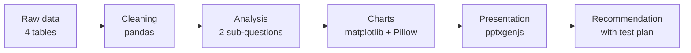

# Eniac · Do the Discounts Pay Off?

**English** · [Deutsch](README.de.md)

### Discount analysis for an online retailer of Apple products

**Do Eniac's discounts pay off?**
A data-driven answer for the CEO: Python → charts → presentation → recommendation

[Project](#project) · [Question](#question) · [Key Numbers](#key-numbers) · [Approach](#approach) · [Findings](#findings) · [Recommendation](#recommendation) · [My Contribution](#my-contribution) · [Files](#files) · [Team](#team)

---

## Project

Eniac is an online retailer of Apple products and accessories in Spain. Almost everything is sold at a discount. The CEO wanted to know whether this pays off. Our task as a team: analyse the sales data from January 2017 to March 2018 and present the answer in a five-minute presentation, with an appendix for follow-up questions.

> Group project in the "Data Analysis and AI" training at WBS Coding School, presented on 13 November 2026. Eniac is a case study provided by the course.

**Outcome:** The instructors rated our presentation the best in the course. The only follow-up question on content, how we would test the recommendation, was fully answered by a prepared appendix slide (calculation and test plan).

## Question

> **Do Eniac's discounts pay off?**

| # | Sub-question | Perspective | Answer |
|---|---|---|---|
| 1 | Do discounts drive revenue? | Marketing | Yes, but not everywhere. |
| 2 | Do discounts cost us revenue and reputation? | Board | Not our reputation, but money in the wrong place. |

**Overall answer:** We're not losing money. But we're missing out on money we could be earning.

## Key Numbers

**Data**

| Metric | Value |
|---|---|
| Period | 437 days (January 2017 to March 2018) |
| Completed orders | 46,605 (of 226,909 before cleaning) |
| Products in the catalogue | 9,992 (of 19,326 before cleaning) |
| Revenue | €15.9M |

**Discounts**

| Metric | Value |
|---|---|
| Discounted items | 93% (56,203 of 60,375) |
| Strongest month | November 2017: €2.89M revenue, 21.5% avg. discount |
| Macs | 41% of revenue, only 10.3% discount, but €0.77M in discount money |
| Apple overall | about 11% discount, but €1.17M in discount money, almost half of all discount money |
| Other brands | about 18% discount, three times as many units sold, but less revenue |

## Approach

1. **Clean the data.** Only completed orders count as revenue. 36,169 unit prices were stored as text in the format `1.234.56`. Because all of them follow this format, the first dot is clearly a thousands separator; we removed it instead of deleting the rows (deleting would have cost about 46% of revenue). In the product catalogue the format was ambiguous, so we deleted 542 prices there: a missing price is visible, a wrongly repaired one silently distorts the discount. We also removed duplicates and rows with missing values.
2. **Build a working table.** Every item sold, with revenue, list-price revenue, discount in percent and in euros, category and brand.
3. **Answer the two sub-questions.** Monthly trend, categories, brands, price classes, and a direct comparison of Apple against all other brands.
4. **Calculate the recommendation.** What one percentage point of Apple discount is worth, how many sales could drop without losing revenue, and what shifting the discount would bring.
5. **Present.** One main question, two sub-questions with short answers, one recommendation with numbers. Everything for follow-up questions goes into an appendix with a linked overview (A1 to A7).

## Findings

### Discounts are standard, but November sells itself

93% of all items are sold at a discount. The strongest month is November 2017, with Black Friday and €2.89M in revenue.

### Macs carry the revenue

Macs bring in 41% of revenue.

### Apple: low discount rate, but almost half of all discount money

Apple gets about 11% discount on average, other brands about 18%. Because Apple devices are expensive, €1.17M in discount money still goes to Apple, almost half of the total.

### Low percentage, high amount

Macs get only 10.3% discount, but in euros that is €0.77M (31% of all discount money). Cases and bags are the opposite: 32.7% discount, but only €0.15M.

## Recommendation

| # | Lever | Reason |
|---|---|---|
| 1 | **Lower the Apple discount** | Each percentage point is worth about €105,000. |
| 2 | **Target discounts at other brands** | There, discounts work as a purchase incentive. |
| 3 | **Discount outside the peak season** | In November, customers buy anyway. |

**Example calculation (January 2017 to March 2018):** With the money saved on the Apple discount, the discount on other brands could rise from 18% to up to 25% at the same budget. Or Eniac keeps the money: up to €0.54M more revenue at the same unit sales.

**Buffer and test plan:** At 7% instead of 11.1% Apple discount, up to 4.5% fewer Apple devices could be sold without losing revenue. Proposed test: offer iPads at 7% instead of 11% discount for six weeks, not in November, and compare with the same weeks of the previous year. If sales drop by less than 4.5%, roll the change out.

### Limits of the data

- **No purchase prices:** margins can only be estimated in scenarios (appendix A4).
- **No customer ID:** new customers and loyalty cannot be measured.

That is why we do not claim that discounts lose money, and propose tests instead.

## My Contribution

The three of us presented together. Organisation, code and design were mostly my part.

#### What I built

- **Project organisation:** set up the group document with a question tree: main question, sub-questions F1 to F6, owners and a consistent template for the answers
- **Cleaning orders and orderlines:** repaired 36,169 prices with two dots instead of deleting them, because otherwise about 46% of revenue would have been missing
- **Analysis of prices and price classes** (sub-question F4)
- **Final code:** revised and unified based on Walter's and Miguel's first versions; one notebook that recalculates every number in the presentation from the raw data
- **Storyline and structure of the presentation:** main question, two sub-questions, answer, recommendation
- **Design:** designed and built all slides, charts and animations; the team adopted this style for the whole presentation
- **Recommendation with example calculation:** €105,000 per percentage point, 4.5% buffer, shifting the discount
- **Preparing for questions:** collected and prioritised likely questions, built the appendix with a linked overview

Walter did the first analyses of revenue and discounts and made the broken price formats in the catalogue visible. We agreed on the cleaning rules together.

#### Presentation

| | Part of the presentation |
|---|---|
| Walter | Data basis, share of discounted items, monthly trend, Macs |
| Miguel | Brand distribution, price classes, Apple vs. other brands |
| Tim | Opening and agenda, interim conclusions, answer, recommendation, appendix |

The presentation was rated the best in the course; the only follow-up question, how we would test the recommendation, could be answered with a prepared appendix slide.

### Key Learnings

- **Preparing for questions pays off.** I had collected and prioritised likely questions. The question about testing came up, and slide A2 answered it.
- **Percent and euros tell different stories.** The smallest discount in percent was the largest amount in euros.
- **Cleaning means making decisions.** Repair where the pattern is unambiguous, delete where it is not, and document both openly.

## Files

| File | Content |
|---|---|
| [`presentation/Eniac_CEO_Presentation_EN.pdf`](presentation/Eniac_CEO_Presentation_EN.pdf) | Presentation with appendix (English) |
| [`presentation/Eniac_CEO_Praesentation.pdf`](presentation/Eniac_CEO_Praesentation.pdf) | Original German presentation |
| [`code/analyse/Eniac_Rabattanalyse.ipynb`](code/analyse/Eniac_Rabattanalyse.ipynb) | Final notebook (German): cleaning, both sub-questions, recommendation, appendix and check against the slides |
| [`code/`](code/) | Further scripts: charts and animations, slide builder, video, English version (overview in [`CODE.md`](code/CODE.md), German) |
| [`images/`](images/) | Charts on this page |

The notebook recalculates every number in the presentation from the four raw files and compares them with the slides at the end. Its outputs are saved, so it can be read directly on GitHub. The raw course data is not included in this repository. The scripts in `code/` are the original scripts behind the presentation and serve as reference; they still contain local paths.

## Team

**Team Discount Detectives:** Walter, Miguel and Tim Aßmann
